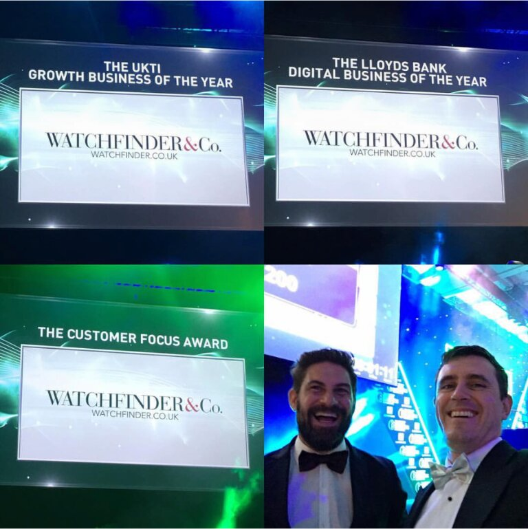

On Tuesday I was at the Grosvenor House on Park Lane in a black tie, watching Watchfinder lose three awards in a row. That sounds bleaker than it felt. It was, genuinely, one of the more surreal evenings I've had in this job.

The occasion was the Lloyds Bank National Business Awards, about as grand as these things get in Britain. We were shortlisted for three: Digital Business of the Year, the Customer Focus Award, and the UKTI Growth Business of the Year. As the person who runs the digital side, the first of those was the one with my name emotionally attached to it. We didn't win it; Digital Business went to UNiDAYS. We didn't win the other two either, which went to Paymentsense and to Go Ape. Three times the table leaned in when our category came up, and three times it was somebody else's name being read out. We clapped each time, and mostly we meant it.

The night itself was ridiculous in the best possible way. Buzz Aldrin gave the keynote; an actual man who has actually stood on the actual moon, addressing a ballroom of people who sell things on the internet. David Cameron turned up on the big screen in a recorded message, being prime-ministerial at us from behind a desk. Jonah Lomu, who used to run straight through entire England back lines, handed out the trophies. And the founder of Go Ape collected the Customer Focus Award, one of the three we had also been shortlisted for, wearing a full gorilla mask; it got the biggest cheer of the night and rather took the sting out of losing that one to him.

I had come with Lloyd Amsdon, one of Watchfinder's co-founders, and Emma, our head of communications, though you don't get to sit together. The awards scatter each company's people across different tables on purpose, seating you among strangers so that everyone is nudged into networking over dinner. I spent the meal making conversation with a table of people I had never met.

Three shortlists and no wins: Digital Business, Customer Focus and UKTI Growth Business, with Watchfinder co-founder Lloyd Amsdon. I put this montage up on Instagram the next morning.

Losing three in a row does make you ask what the whole exercise is for, especially when you go home empty-handed.

Being shortlisted at this level is worth something on its own, and I don't mean that as a consolation prize. The entry process alone forces you to write down, plainly, what you have actually achieved and why it mattered, which is a useful thing to be made to do even if only the judges ever read it. Sitting in that room gives you a proper sense of the company you are keeping and the calibre of business you are measured against. And the Digital Business shortlist in particular was a sign that the digital work at Watchfinder is being noticed well beyond our own four walls.

I wouldn't chase awards purely for the sake of them. They cost real time and money to enter, and winning one has never directly sold us anything. As a by-product of doing good work, though, and as a way to measure yourself against the best in the country, I have warmed to them more than I expected to.

There was a smaller, nerdier pleasure in the evening too. Watchfinder's whole business is watches, so it felt right to wear my own Omega Speedmaster to the dinner, the one with the aventurine dial that looks like a shard of the night sky. The Speedmaster is the watch Buzz Aldrin wore on the moon, and Aldrin had given the keynote a few hours earlier.

We didn't win any of the three, and I would be lying if I said that did not sting a little on the way out. But a few years ago I would have had no business in a room like that, and I spent the evening in it, at a table of strangers, watching Buzz Aldrin and Jonah Lomu hand out the trophies.
