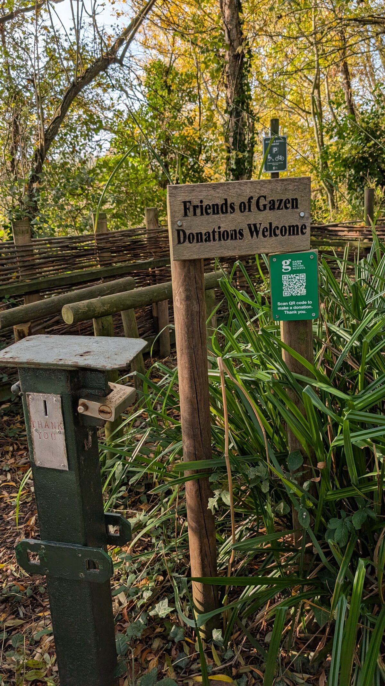
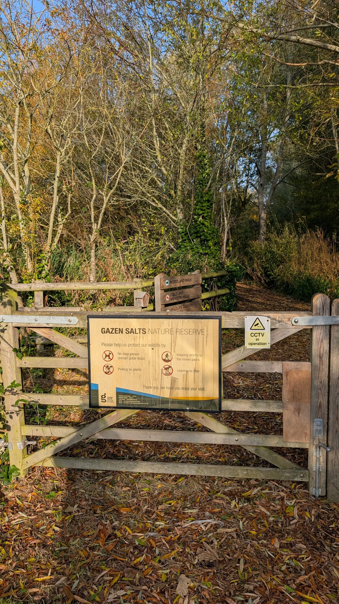
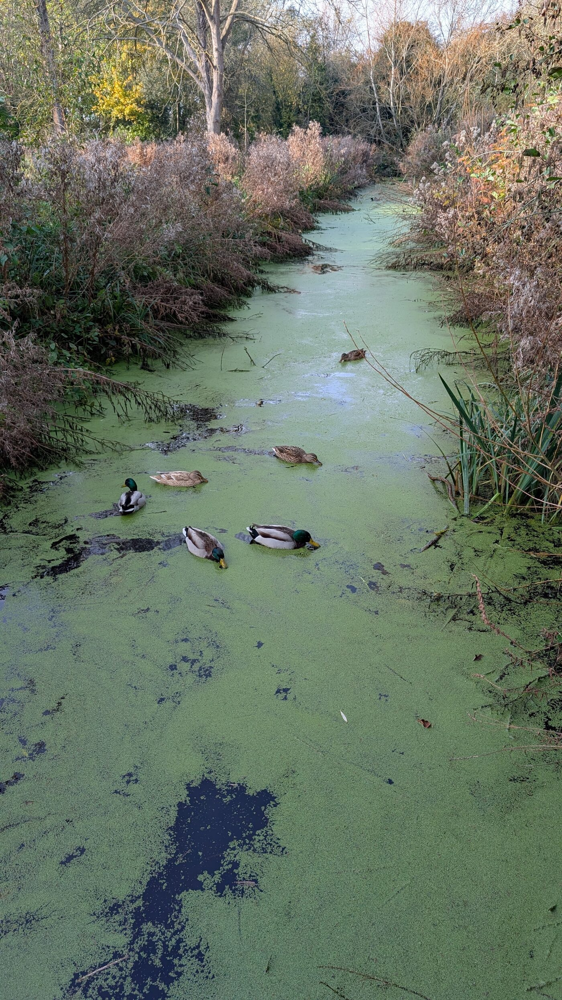
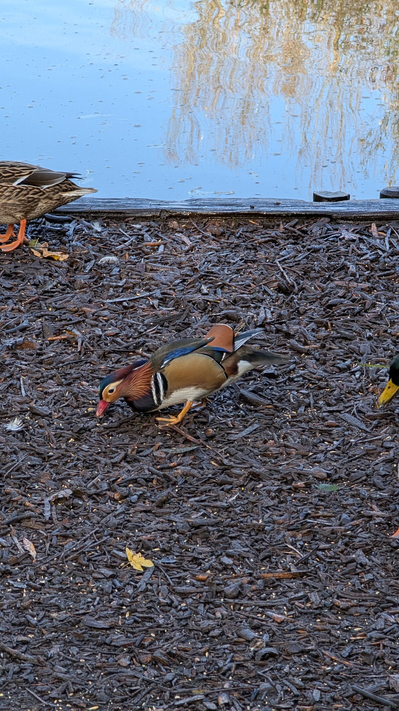
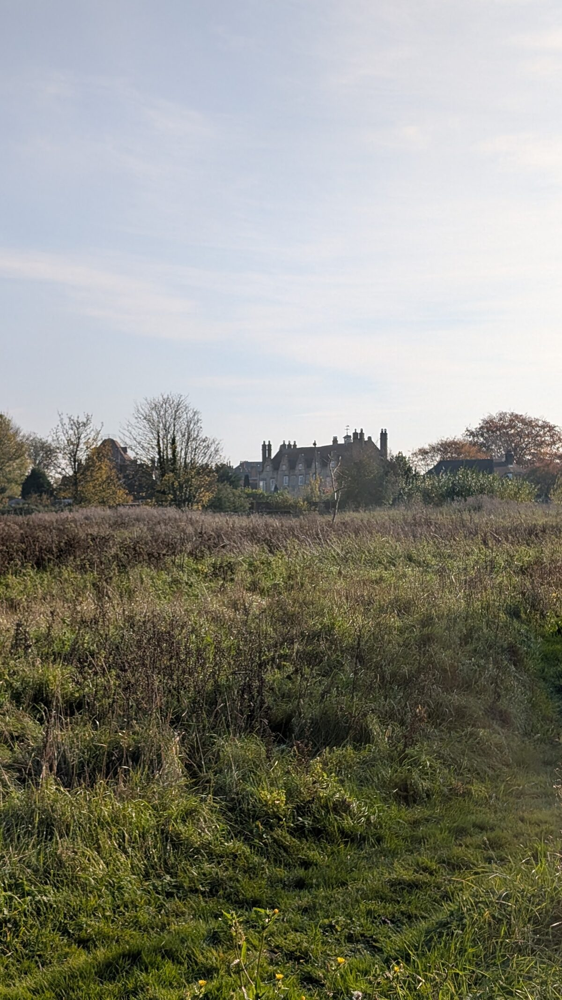

There is a small nature reserve folded into a loop of the River Stour at Sandwich. I have known it since I was a boy, and I went back this morning for the first time in years.

Gazen Salts is about fifteen acres of woodland, water and reedbed, tucked off Strand Street behind the old town. The entrance is easy to miss. Most people who come to Sandwich come for the medieval streets, the Quay, the toll bridge over the Stour, and never find out that two minutes from the town centre there is a lake with a kingfisher on it.

I came here as a kid, with my sister Mary and our friends Elenor and Madeline. The dykes then were as choked with weed as they are now, and half-sunk logs drifted about in them, and I had decided the logs were crocodiles. I more or less believed it myself. Better than that, I talked Mary into believing it too, and winding her up was most of the point. I did not know then that the whole place was man-made, and barely older than I was. It felt like it had always been there.

## A reserve with a strange name and a made-up past

The name throws people. It is not "Grazen", and it has nothing to do with grazing. "Salts" is the old word for the saltings, the tidal salt marsh along the Stour. "Gazen" is a worn-down surname: a man called **John Gason** held the lease on these saltings in the seventeenth century, and over a few hundred years "Gason's salts" slurred into "Gazen Salts". The place is still named after a tenant farmer nobody remembers.

The reserve itself is younger than it looks. It was dug out in **1973**, designed by a local naturalist called Dennis Harle, on ground that had been grazing fields, old allotments, a disused rubbish tip and a builder's yard. Not promising material. Fifty years on it has a lake, a scrape, a round pond, reedbeds and a ring of woodland with something like sixty species of tree and shrub, and over 160 kinds of bird recorded. There is a memorial to Harle near the middle of the reserve.

## The years it was shut

There was a long stretch when you could not get in at all, and I walked straight into it. Back in 2016 I decided to bring my own family to the place I remembered. I wanted to show them the lake, the woods, the secret-feeling bit of Sandwich I had carried around in my head since I was a boy. We got there and it was shut. Gate closed, no way in. I had built the whole trip up and then stood outside, unable to show them any of it. We drove up the road to Richborough Fort instead and made an afternoon of the Roman ruins - a good day out, just not the one I had planned.

What I did not know at the time was why. In December 2013 a tidal surge put Sandwich under water, and Gazen Salts, sitting in its river loop, took the full force of it. The brackish ecosystems the reserve had spent forty years building were, in the words of its own leaflet, "all but destroyed". It closed, and it stayed closed for years. That is what I had walked into on the day; I just did not know it at the time.

## The people who brought it back

In 2019 a group of volunteers simply set to work. No grand reopening, no fanfare that I ever saw; just people turning up to reclaim and regenerate a flooded wreck of a place, Wednesday morning after Wednesday morning. It is run entirely by the Gazen Salts Trust now, a registered charity kept going by those volunteers and by donations, with help over the years from Dover District Council, the Sandwich Toll Bridge Fund and the Kent Community Foundation.

They still meet every Wednesday, nine until noon, all year round. That is the only reason the gate was open when I turned up this morning.

<figure class="text-center my-4">
  
  <figcaption class="caption mt-2">The whole operation runs on this. An old iron honesty box and a QR code, and the Wednesday crew.</figcaption>
</figure>

## What it is like now

<figure class="text-center my-4">
  
  <figcaption class="caption mt-2">The gate I could not get through last time. No dogs, keep to the mown paths, and in you go.</figcaption>
</figure>

I did a slow loop, a shade under two and a half kilometres, in no particular hurry. It is flat, easy, and the two marked trails more or less cover it: a Woodland Walk the leaflet reckons at 35 minutes, and a shorter Field and Meadow Walk at 25. Together they take you round the lot.

The lake is the heart of it, fed through a sluice from the tidal Stour, so the water is brackish and the wildlife is the sort you get where fresh meets salt: moorhens, wildfowl, and if you are lucky the electric-blue flash of a kingfisher. There is a scrape in the north corner slowly pulling in wading birds, a Round Pond that is the only proper freshwater on the site, and reedbeds that fill with sedge and reed warblers in summer. The dykes between them were carpeted end to end in bright green duckweed, mallards ploughing furrows through it.

<figure class="text-center my-4">
  
  <figcaption class="caption mt-2">One of the dykes, green from bank to bank. Still no crocodiles, Mary. I checked.</figcaption>
</figure>

Down at the feeding station the regulars were out in force, and among the mallards, improbably, a mandarin drake: copper cheeks, mad orange sail-feathers, the lot, picking seed off the wood chip as if he owned it. Not native, mandarins, but long escaped and thoroughly at home. The leaflet also claims, straight-faced, that there is now evidence of beavers on the reserve, and tells you to watch for chewed branches. I looked, and did not see one.

<figure class="text-center my-4">
  
  <figcaption class="caption mt-2">A mandarin drake, gatecrashing the mallards' breakfast.</figcaption>
</figure>

<figure class="text-center my-4">
  <video controls muted playsinline preload="metadata" poster="/assets/gazen-salts/ducks-feeding-poster.jpg" class="img-fluid rounded mx-auto d-block" style="max-height:640px">
    <source src="/assets/gazen-salts/ducks-feeding.mp4" type="video/mp4">
  </video>
  <figcaption class="caption mt-2">Breakfast at the feeding station, the whole greedy committee of them.</figcaption>
</figure>

My favourite corner is Gallows Field, at the southern end, mostly for the name. It is exactly what it sounds like: this is where Sandwich used to hang and bury its criminals. Now it is a rough wildflower meadow, butterflies in summer and harvest mice according to the leaflet, with the chimneys and rooftops of the old town rising just beyond the grass.

<figure class="text-center my-4">
  
  <figcaption class="caption mt-2">Gallows Field, with Sandwich's old roofs just over the grass.</figcaption>
</figure>

<strong>If you go</strong>
<ul class="mb-0">
<li><strong>Where:</strong> off Strand Street, Sandwich, Kent, CT13 9HN. Public paying car park opposite St Mary's Church; the station and buses are about 15 minutes' walk.</li>
<li><strong>Cost:</strong> free, no opening restrictions.</li>
<li><strong>Dogs:</strong> not allowed (assistance dogs excepted). Keep to the paths.</li>
<li><strong>Trails:</strong> Woodland Walk (~35 min) and Field and Meadow Walk (~25 min), both flat and easy.</li>
<li><strong>Support them:</strong> it runs on volunteers and donations - <a href="https://www.gazensalts.co.uk" target="_blank" rel="noopener">gazensalts.co.uk</a>. They meet Wednesdays, 9 to noon.</li>
</ul>

I will bring the family back now the gate is open again. Later than I meant to by about thirty years. But it is open, and that is down to the Wednesday crew, not to me.

---

### The walk

| | |
| --- | --- |
| **Distance** | 2.5 km (1.5 miles) |
| **Time** | 45 minutes, dawdling |
| **Ascent** | Flat (about 5 m) |
| **Start/finish** | Strand Street entrance, Sandwich |
| **Terrain** | Level wood-chip and grass paths; can get muddy |
| **Of note** | A small, man-made reserve that survived a flood and a long closure |

Two routes below: a **short** reserve loop (about 2.4 km, flat), and a **longer** Sandwich circular (about 2.9 km) that strings Gazen Salts together with the Quay, the toll bridge and the riverside path along the Stour. Neither is precisely the line I walked; they are there to plan your own from the map. Download the GPX or KML to load onto a phone or watch.



  <a class="btn btn-accent btn-sm" href="/assets/routes/gazen-salts-reserve-loop.gpx">Short loop GPX</a>
  <a class="btn btn-accent btn-sm" href="/assets/routes/gazen-salts-reserve-loop.kml">Short loop KML</a>
  <a class="btn btn-accent btn-sm" href="/assets/routes/gazen-salts-sandwich-circular.gpx">Long circular GPX</a>
  <a class="btn btn-accent btn-sm" href="/assets/routes/gazen-salts-sandwich-circular.kml">Long circular KML</a>

